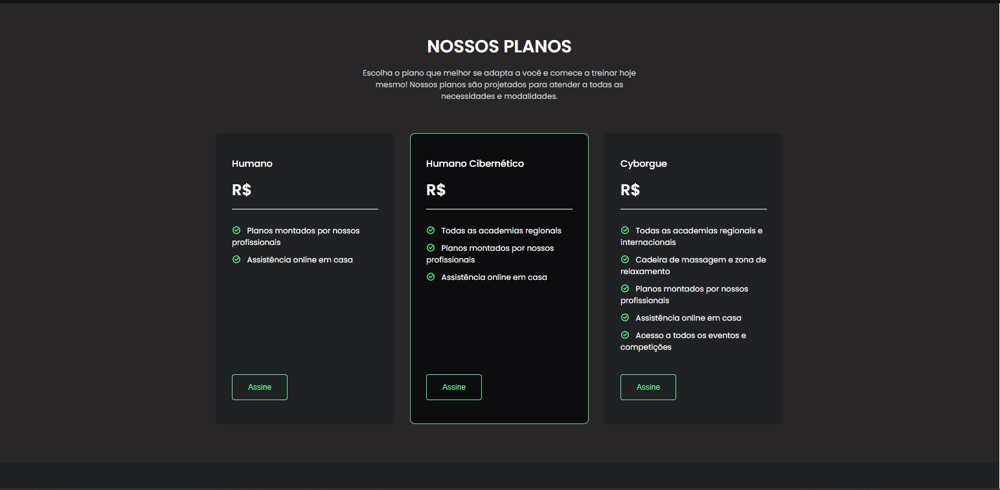
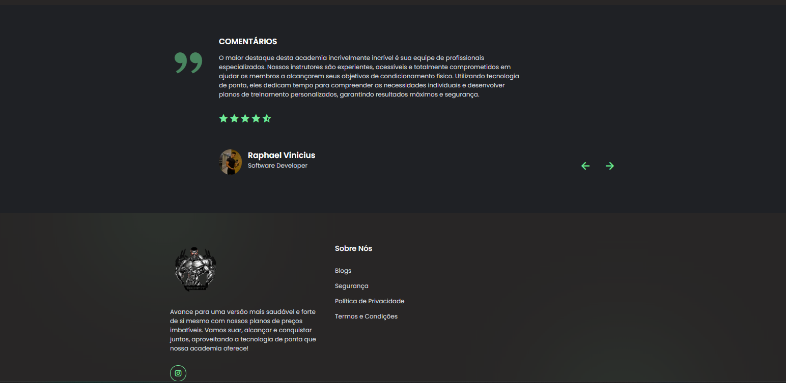

# TechFit

Site e API de uma academia, feito como projeto de Laboratório de Engenharia de Software (2024).
Demo: https://tech-fit.vercel.app





## Tecnologias

- Front-end: HTML, CSS e JavaScript puro (`src/`)
- Back-end: Node.js, Express, Sequelize e PostgreSQL
- Autenticação: JWT + senhas com hash (bcryptjs)

## Como rodar

Requer Node.js 20.17 ou superior e Docker (para o PostgreSQL).

```bash
npm install
cp .env.example .env   # e troque as senhas e o JWT_SECRET por valores fortes
npm run db:up          # sobe o PostgreSQL em contêiner
npm run db:setup       # cria tabelas, planos, treino e a conta admin
npm run dev            # ou: npm start
```

Sem Docker? Qualquer PostgreSQL 16 serve: crie o banco `techfit` e aponte `DATABASE_URL` para ele
(neste computador foi usado o PostgreSQL portátil da EnterpriseDB, fora do projeto).

Acesse http://localhost:3000. O admin entra com `ADMIN_EMAIL` / `ADMIN_PASSWORD` do `.env` e acessa o painel em `/pages/admin/admin.html`
(também aparece o botão "Painel admin" na área do cliente).

## Variáveis de ambiente

| Variável                                      | Descrição                                                                                   |
| --------------------------------------------- | ------------------------------------------------------------------------------------------- |
| `PORT`                                        | Porta do servidor (padrão `3000`)                                                           |
| `JWT_SECRET`                                  | Segredo dos tokens (obrigatório em produção)                                                |
| `DATABASE_URL`                                | String de conexão do PostgreSQL                                                             |
| `DATABASE_SSL`                                | `true` para bancos hospedados que exigem SSL                                                |
| `POSTGRES_PASSWORD`                           | Senha do PostgreSQL criado pelo `docker-compose.yml`                                        |
| `ADMIN_NOME`, `ADMIN_EMAIL`, `ADMIN_PASSWORD` | Conta admin criada pelo `npm run db:setup`                                                  |
| `TRUST_PROXY`                                 | Nº de proxies à frente do app (Vercel, Render...), p/ o limite de requisições ver o IP real |
| `TEST_DATABASE_URL`                           | Banco só dos testes (precisa terminar em `_test`)                                           |
| `CORS_ORIGIN`                                 | Origem permitida no CORS (padrão: qualquer)                                                 |

## Qualidade

```bash
npm test              # Jest + Supertest (usa o banco techfit_test)
npm run lint          # ESLint
npm run format:check  # Prettier (use npm run format para corrigir)
```

Os testes apagam as tabelas do banco de testes, então ele é separado: crie-o uma vez com
`createdb techfit_test`. Sem `TEST_DATABASE_URL`, usa o `DATABASE_URL` com o sufixo `_test`.
O GitHub Actions (`.github/workflows/ci.yml`) roda lint, formatação e testes a cada push, com um PostgreSQL temporário.

## Segurança

- `helmet`: cabeçalhos de segurança e Content-Security-Policy (CDNs liberados: jsDelivr e Google Fonts).
- Limite de requisições: login e redefinição de senha (10 falhas a cada 15 min por IP), recuperação de senha (5 por hora) e cadastro (20 por hora). Atrás de proxy, defina `TRUST_PROXY`.
- Senhas com bcrypt, tokens de recuperação guardados só como hash, corpo JSON limitado a 50 kb.

## API

| Método | Rota               | Auth | Descrição                                                          |
| ------ | ------------------ | ---- | ------------------------------------------------------------------ |
| POST   | `/register`        | não  | Cadastra usuário (`nome`, `email`, `senha`)                        |
| POST   | `/login`           | não  | Retorna `{ token }` (válido por 2 horas)                           |
| POST   | `/esqueci-senha`   | não  | Gera o link de recuperação (`email`)                               |
| POST   | `/redefinir-senha` | não  | Define nova senha (`token`, `senha`)                               |
| GET    | `/planos`          | não  | Lista os planos                                                    |
| GET    | `/cliente`         | sim  | Dados do usuário logado e plano atual                              |
| PUT    | `/cliente`         | sim  | Atualiza `nome` e `email`                                          |
| PUT    | `/cliente/senha`   | sim  | Troca a senha e devolve um `token` novo; encerra as outras sessões |
| PUT    | `/cliente/plano`   | sim  | Escolhe o plano (`planoId`)                                        |
| GET    | `/treino`          | sim  | Treino do mês                                                      |

Rotas com auth usam o cabeçalho `Authorization: Bearer <token>`.

> **Recuperação de senha:** ainda não há envio de e-mail. O link de redefinição é impresso no console do servidor (vale por 30 minutos e só pode ser usado uma vez).

### Rotas de admin (exigem papel `admin`)

`GET /admin/usuarios` (paginação `?limit=&offset=`, total em `X-Total-Count`), `PATCH /admin/usuarios/:id` (papel, planoId), `DELETE /admin/usuarios/:id`, `POST /admin/planos`, `PUT /admin/planos/:id`, `DELETE /admin/planos/:id`.

## Estrutura

```
server.js        servidor e rotas
config/          conexão com o banco
models/          modelos Sequelize (User, Plano, Treino) e carga inicial
routes/          rotas da API
middleware/      autenticação JWT
src/             site (páginas, scripts, estilos e imagens)
```

## Dados e validação

- Toda entrada passa por `utils/validacao.js` (nome 2–100 caracteres, e-mail normalizado em minúsculas, senha de 6 a 72 bytes, ids inteiros positivos, plano com preço inteiro de 0 a 100000).
- O token de login deixa de valer se o usuário foi apagado ou trocou a senha depois de emiti-lo.
- Erros inesperados vão para um tratador central (resposta 500 genérica, detalhe só no log).
- `iniciarBanco()` também aplica ajustes em bancos antigos (coluna `senhaAlteradaEm` e índices), sem apagar dados.
